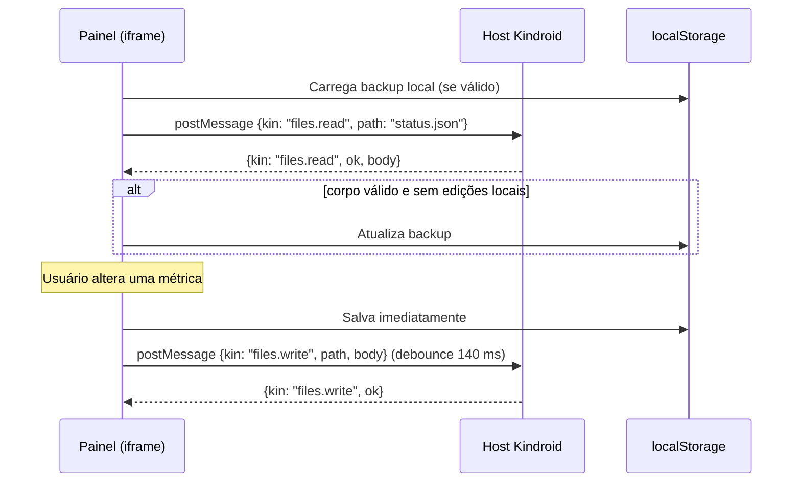

<div align="center">

# 📊 Status Bar — Painel experimental para Kindroid

**Um painel leve, open source e sem dependências, que exibe e persiste quatro métricas de status de um companheiro virtual.**

Desenvolvido para o **Apps Workshop do Kindroid (alpha)**.


</div>

---

## Sumário

- [Visão geral](#visão-geral)
- [Objetivo](#objetivo)
- [Funcionalidades](#funcionalidades)
- [Como funciona](#como-funciona)
- [Estrutura do repositório](#estrutura-do-repositório)
- [Começando](#começando)
- [Modelo de dados](#modelo-de-dados)
- [Privacidade e segurança](#privacidade-e-segurança)
- [Roadmap](#roadmap)
- [Contribuindo](#contribuindo)
- [Licença](#licença)

## Visão geral

O **Status Bar** é um *panel* (tela embutida) open source criado para o **Apps Workshop do Kindroid**, o ambiente de mini‑apps atualmente em fase alpha. Ele mostra um cartão de perfil de demonstração com quatro indicadores — **Energia**, **Humor**, **Social** e **Estresse** — que podem ser ajustados manualmente, simulados por um "tick" determinístico e salvos entre sessões.

> [!IMPORTANT]
> Os valores são **fictícios e controlados manualmente**. O painel **não lê nem altera** atributos reais de nenhum Kin. É um ambiente de testes (sandbox).

## Objetivo

Este projeto existe para **validar a infraestrutura** necessária a um futuro painel de status de companheiros:

1. **Ponte de arquivos do Kindroid** — confirmar que um painel consegue ler e gravar um arquivo (`status.json`) através do host via `postMessage`.
2. **Persistência entre sessões** — garantir que o estado sobreviva ao fechamento do painel, com fallback para `localStorage`.
3. **Contrato de dados estável** — definir um esquema versionado e validado para as métricas.
4. **Padrão visual e de acessibilidade** — estabelecer uma UI escura, responsiva e acessível que sirva de base para versões futuras.

## Funcionalidades

| Recurso | Descrição |
| --- | --- |
| 🎚️ Controles deslizantes | Ajuste de cada métrica de 0 a 100%, com feedback em tempo real. |
| ↻ Tick de demonstração | Aplica uma variação determinística (`energia −4`, `humor +2`, `social −1`, `estresse +3`). |
| 💾 Persistência dupla | Grava no host Kindroid (`status.json`) e mantém backup no `localStorage`. |
| 🔄 Recarregar estado | Solicita novamente o arquivo salvo ao host, sem sobrescrever edições locais. |
| ⬇️ Exportar JSON | Baixa um *snapshot* do estado atual (`status-bar-state.json`). |
| 🩺 Diagnóstico | Mostra o estado da ponte com o host e o tipo de persistência em uso. |
| 📝 Log de atividades | Histórico das últimas 6 ações, anunciado a leitores de tela (`aria-live`). |
| ♿ Acessibilidade | Rótulos ARIA, foco visível, `prefers-reduced-motion` e layout responsivo. |

## Como funciona



Detalhes completos do protocolo e das regras de validação estão em [`docs/ARCHITECTURE.md`](docs/ARCHITECTURE.md).

Para onde o projeto vai: [`docs/VISION.md`](docs/VISION.md) (visão do motor de simulação) e [`docs/FEASIBILITY.md`](docs/FEASIBILITY.md) (viabilidade e fases).

## Estrutura do repositório

```text
.
├── src/                    # Código-fonte legível do painel
│   ├── kin.json            # Manifesto do mini-app (nome, propósito, telas)
│   └── screen/index.html   # Painel completo (HTML + CSS + JS, sem build)
├── data/<id>/status.json   # Estado persistido de exemplo
├── code/                   # Pacotes originais exportados (.tar.gz e git bundle)
├── programs.json           # Registro do programa no workspace
├── schemas/                # JSON Schema do estado persistido
└── docs/                   # Documentação técnica
```

> O identificador interno do programa é `l2db25ce23fa61463f3ab`.

## Começando

Não há etapa de build nem dependências. Basta servir a pasta `src/`:

```bash
python3 -m http.server 8080 --directory src
```

Depois abra <http://localhost:8080/screen/index.html>.

Fora de um iframe, o painel roda em **modo standalone**: a ponte com o Kindroid fica inativa e o estado é salvo apenas no `localStorage` do navegador.

### Regenerar o pacote

```bash
tar -czf code/l2db25ce23fa61463f3ab.tar.gz -C src kin.json screen/index.html
```

## Modelo de dados

```json
{
  "schemaVersion": 1,
  "revision": 0,
  "updatedAt": "2026-11-17T06:00:00.000Z",
  "values": { "energy": 74, "mood": 86, "social": 48, "stress": 23 }
}
```

| Campo | Tipo | Regra |
| --- | --- | --- |
| `schemaVersion` | inteiro | Sempre `1` nesta versão. |
| `revision` | inteiro ≥ 0 | Incrementado a cada alteração. |
| `updatedAt` | string ISO 8601 | Momento da última alteração. |
| `values.*` | inteiro 0–100 | Exatamente as chaves `energy`, `mood`, `social`, `stress`. |

Esquema formal: [`schemas/status.schema.json`](schemas/status.schema.json).

## Privacidade e segurança

- **Nenhuma requisição externa** — não há chamadas de rede, CDNs ou analytics.
- **Mensagens filtradas** — só aceita `postMessage` vindos de `window.parent` e, quando conhecida, da origem do `document.referrer`.
- **Validação estrita** — qualquer estado fora do esquema é descartado.
- **Sem dados reais** — nenhum atributo de Kin é lido ou modificado.

Para reportar vulnerabilidades, veja [`SECURITY.md`](SECURITY.md).

## Roadmap

- [x] **v0.1.0** — Protótipo inicial com as quatro métricas.
- [x] **v0.2.0** — Adaptação ao formato de painel do Kindroid, ponte de arquivos e diagnóstico.
- [ ] **Motor de simulação de vida do Kin** — corpo, mente e relacionamento em tempo real. Veja a [visão](docs/VISION.md) e a [análise de viabilidade](docs/FEASIBILITY.md).
- [ ] Testes automatizados de validação do esquema e da ponte (mock do host).
- [ ] Migração de esquema (`schemaVersion` 2) com métricas configuráveis.
- [ ] Histórico/gráfico de evolução das métricas.
- [ ] Integração opcional com dados reais do Kin, mediante permissão explícita.
- [ ] Internacionalização (pt-BR / en).

## Contribuindo

Contribuições são bem-vindas! Leia o [guia de contribuição](CONTRIBUTING.md) e consulte o [CHANGELOG](CHANGELOG.md) para o histórico de versões.

## Licença

Distribuído sob a licença [MIT](LICENSE). Você pode usar, modificar e redistribuir livremente, mantendo o aviso de copyright.

> Este é um projeto independente da comunidade e não é afiliado oficialmente ao Kindroid. "Kindroid" é marca de seus respectivos proprietários.
